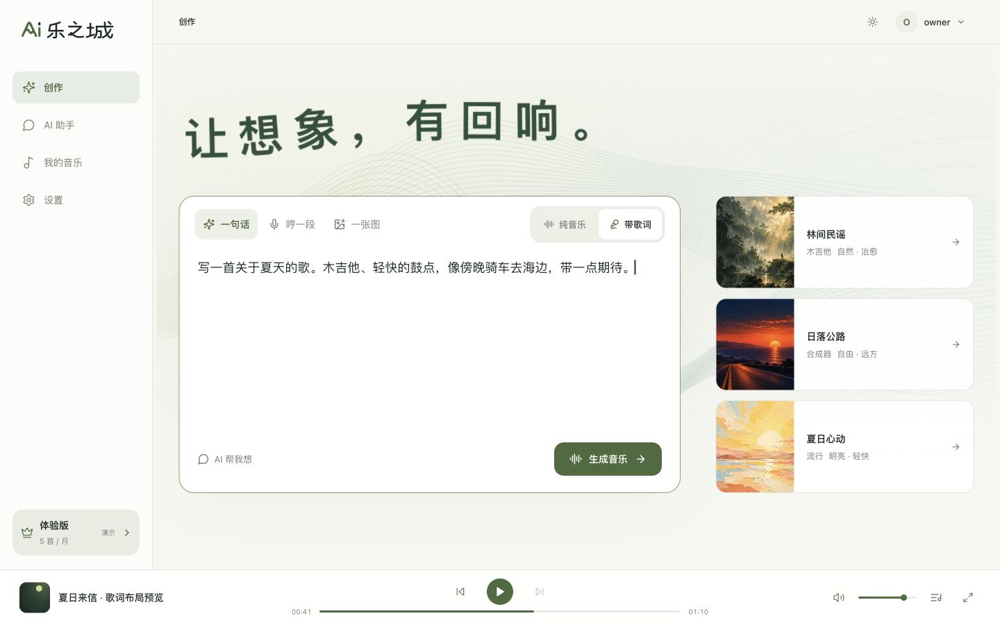
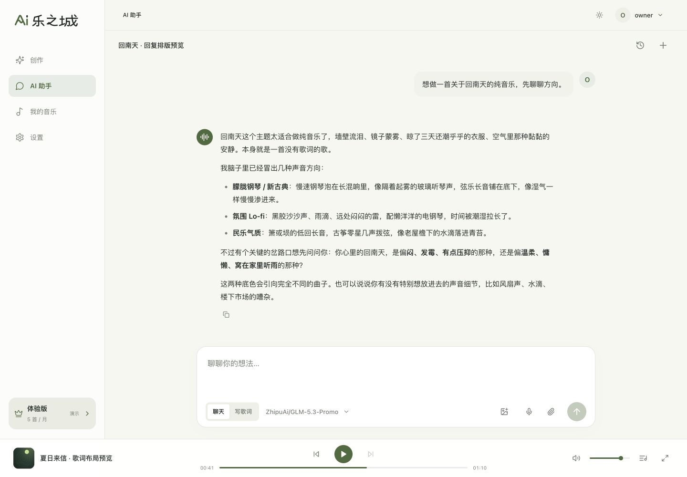
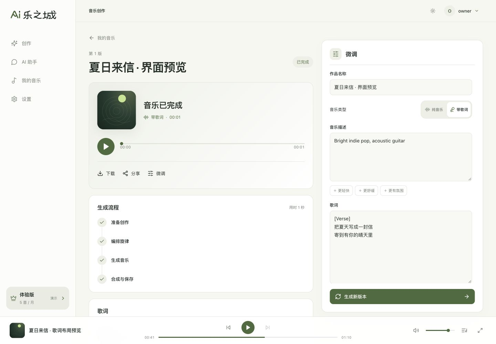
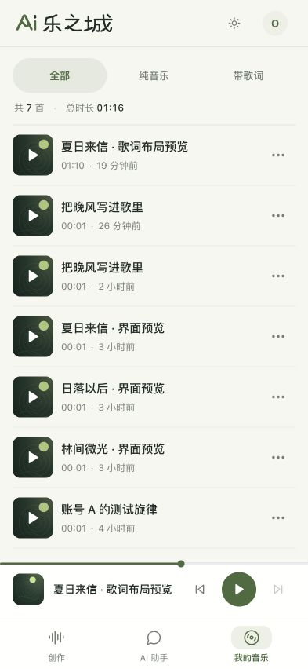
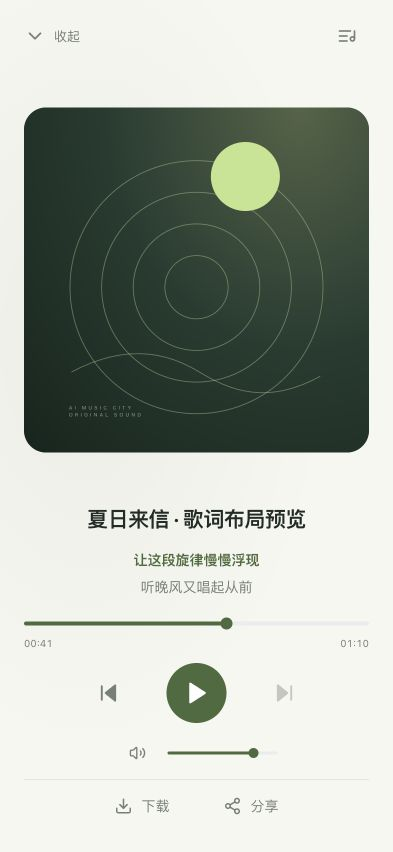
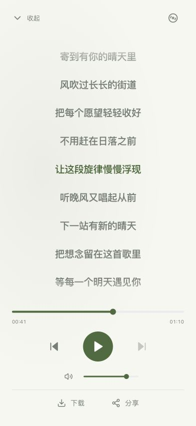

# AI乐之城

**让想象，有回响。**

一句话、一段哼唱，或一张图片，把脑海里的声音变成自己的音乐。先与 AI 助手聊聊，也可以直接开始创作；生成后试听、微调、下载和分享。



## 可以做什么

| | |
| --- | --- |
| **三种创作方式** | 描述想法、录制哼唱、上传图片，可选择纯音乐或带歌词。图片用于提炼画面的氛围与配器方向。 |
| **一起构思的 AI 助手** | 用文字、图片或语音交流，支持聊天和写歌词。想法明确后汇总成创作卡片，一键提交生成。 |
| **看得见的生成过程** | 查看任务阶段与结果，修改曲风、歌词或音乐类型，生成新版本并保留原作。 |
| **自己的音乐库** | 按类型筛选，试听作品、下载音频，或通过系统文件分享发送给朋友。 |
| **桌面与手机播放** | 固定播放条、全屏播放器、封面下的歌词预览与完整歌词视图；有可靠时间信息时同步高亮。 |
| **独立账号与 AI 配置** | 每个账号拥有自己的作品、对话和设置。自定义 Base URL / API Key，从服务的 `/models` 选择模型，并测试连接。 |

## 界面预览

### 聊清楚想法，再生成

模型与聊天模式都在输入框内切换，快捷灵感只填入输入框。助手回复支持 Markdown 排版和快捷复制，切换站内页面后仍会继续回答。



### 试听，然后调整

生成流程、试听结果和微调放在同一页。确认修改后生成新的版本。



### 手机上的音乐库与播放器

<table>
  <tr>
    <th width="33%">我的音乐</th>
    <th width="33%">封面与歌词预览</th>
    <th width="33%">完整歌词</th>
  </tr>
  <tr>
    <td></td>
    <td></td>
    <td></td>
  </tr>
</table>

以上为本地测试账号的实际界面截图，作品与对话为演示数据，静音音轨和预置歌词时间仅用于展示交互，不代表音乐生成效果或速度。

## 快速开始

真实音乐生成使用 **YuE2 / MLX**，需要 Apple Silicon Mac、原生 arm64 Python 3.12、`uv`、Node.js / npm 和 `ffmpeg`。建议至少 16 GB 统一内存，并为基础模型预留约 15 GB 空间。

当前产品开发分支为 `feature/acestep-vectron`：

```sh
git clone --branch feature/acestep-vectron https://github.com/TeddyBobby/ai-music-city.git
cd ai-music-city
uv sync
npm ci --prefix frontend
npm run build --prefix frontend
uv run python scripts/setup.py
uv run yue2-studio --open
```

打开 [127.0.0.1:8765](http://127.0.0.1:8765/)，注册本地账号即可进入。哼唱和纯音乐需额外模型，详见 [安装与使用指南](docs/setup.md)。

只想体验界面与任务流程，可完成依赖安装和前端构建后，跳过模型下载：

```sh
YUE2_STUDIO_HOME=/tmp/ai-music-city-preview uv run yue2-studio --fake --port 8766 --open
```

`--fake` 使用模拟音乐引擎，输出静音音频；AI 助手与图片分析仍会调用配置的服务。

## 配置 AI 助手

在 **设置 → AI 助手** 填入 Base URL 和 API Key，测试连接后保存。内置 OpenAI、DeepSeek、Kimi 中国内地的快捷地址，也支持其他 OpenAI 兼容服务。

模型列表只取当前服务的 `/models` 返回，图片输入需要所选模型支持视觉。个人密钥保存在服务端，不通过配置查询接口回传。语音转写、服务器默认连接和歌词校准见 [详细配置](docs/setup.md#ai-助手连接)。

## 开发与文档

前端使用 React、TypeScript、Mantine，后端使用 FastAPI，音乐推理通过 MLX 在本机执行。AI 对话与图片理解依赖配置的外部服务。订阅与价格页面目前仅为演示，未接入支付。

```sh
# 后端
uv run yue2-studio --reload

# 另开终端启动前端，默认端口 5173
npm run dev --prefix frontend

# 检查、测试与构建
npm run check --prefix frontend
npm test --prefix frontend
npm run build --prefix frontend
uv run pytest
```

- [安装、模型与使用指南](docs/setup.md)
- [HTTP API](docs/API.md)
- [前端开发](frontend/README.md)
- [上游引擎开发说明](docs/development.md)
- [截图说明](docs/images/product/README.md)

作品、模型、日志与个人连接配置不随仓库分发。运行数据位于 `data/`，迁移和备份方式见 [账号与本地数据](docs/setup.md#账号与本地数据)。

## 许可与来源

本项目基于 [ianiv/YuE2](https://github.com/ianiv/YuE2) 的 YuE2 Studio 扩展，代码遵循 [MIT License](LICENSE)，保留原作者 Ianiv Schweber 的版权声明。原版说明保存在 [docs/upstream/README.md](docs/upstream/README.md)。

代码许可不覆盖模型：上游说明中的 YuE2-3B、MLX 转换权重、VAE 及示例 LoRA 为 **CC BY-NC 4.0（非商业使用）**。使用其他适配器、素材或外部服务时，应分别核对其许可与条款。模型权重及凭据不包含在仓库中。
